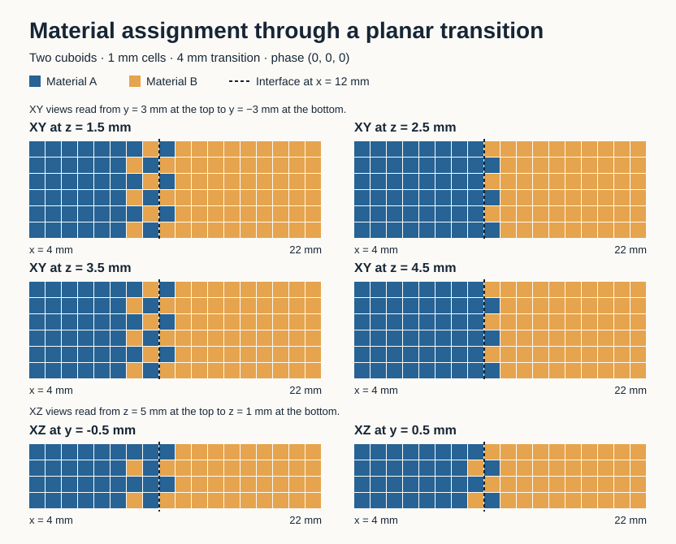

# OrcaSlicer 3DSpectrum

3DSpectrum is an experimental FDM slicer for printing gradual transitions between two filaments within one part. Set a plane where the materials should meet, then choose how wide the transition should be. The goal is to control where material properties change inside a print, including at interfaces between CAD bodies.

## What works today

- **Adjustable transition.** Position or rotate the plane, assign filaments A and B, and set the transition width with a slider or an exact millimeter value. The plane is the 50/50 target. The band edges mark the pure A and pure B targets.
- **Within-layer gradients.** A vertical or tilted plane can route both filaments within the same layer. The slicer approximates the target fractions by assigning short sections of walls and infill to either filament.
- **Shared CAD faces.** For two touching solids imported as one object, the slicer can align the plane to a fully shared flat face. Both CAD bodies keep their original placement and slice as one continuous part across the interface. The two solids need matching base print settings.
- **Explicit opt-in.** Alignment previews the plane. Applying the transition enables it for the selected object and saves the settings in the native 3MF project.

*Standalone simulation of a 4 mm transition. See the [fixture and material fraction measurements](docs/test-results/P1-003-preview.md).*

## Try it in Prepare

1. Select one solid or one object with two solid parts. Configure two physical filaments with matching nozzle diameters.
2. Turn on **Advance** if needed, then open **Cut → Planar → Material transition**.
3. Move or rotate the plane. For two parts that share a complete flat face, choose **Align to shared face**.
4. Pick filaments A and B, set the **Transition width**, and select **Apply transition**.
5. Slice the plate and select **Filament** in Preview to see where each filament is assigned.

The Windows prototype has been checked with horizontal, tilted, diagonal XY and two-body STEP fixtures. The Bambu Lab H2D profile is for offline slicing. Physical nozzle mapping, purge and switching behavior, and the strength of the printed transition still need hardware validation.

## Where the project is going

The next milestone is to qualify the toolpaths on a specific printer and compare printed transition specimens with sharp-interface controls. Later work will extend the approach to curved interfaces and assemblies with more complex contacts. A robotic gripper with rigid and flexible regions is the planned demonstrator. See the [project plan](docs/PROJECT_PLAN.md), [current status](docs/PROJECT_STATE.md), and [architecture](docs/ARCHITECTURE.md).

## Build and test

Build from source using the [Windows Release recipe](docs/TESTING.md#reproduce-on-windows). The [validation guide](docs/TESTING.md) covers the standalone planar sampler, native 3MF round-trips, and offline G-code checks. The [engineering log](docs/DOCUMENTATION.md) records the test results and known baseline failures.

## Credits and license

3DSpectrum builds on [FullSpectrum](https://github.com/ratdoux/OrcaSlicer-FullSpectrum) by ratdoux, which builds on [Snapmaker Orca](https://github.com/Snapmaker/OrcaSlicer) and [OrcaSlicer](https://github.com/OrcaSlicer/OrcaSlicer). FullSpectrum's virtual mixed-color filaments remain a separate feature, with color blending powered by [FilamentMixer](https://github.com/justinh-rahb/filament-mixer). See [LICENSE.txt](LICENSE.txt) for the GNU Affero General Public License, version 3.
